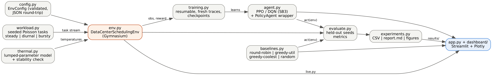

# Deep RL for Thermal-Aware Workload Scheduling in Data Centers

B.Tech CSE Major Project, IILM University (2026-27). A **simulation-based** study:
a configurable data-centre simulator, heuristic baselines, PPO/DQN agents, a fair
evaluation pipeline and a Streamlit dashboard.

> **Honest status:** the trained DRL agents do **not** outperform the best heuristic
> (greedy-coolest) in the current experiments. See `docs/RESULTS.md`. Nothing here was
> validated on real hardware.



## Quick start (Windows, PowerShell, VS Code terminal)
```powershell
cd thermal-drl-scheduler
py -3.11 -m venv .venv
.\.venv\Scripts\Activate.ps1
# if activation is blocked:  Set-ExecutionPolicy -Scope Process Bypass
python -m pip install --upgrade pip
pip install -r requirements.txt
python -m pytest -q                      # run the tests
streamlit run app.py                     # open the dashboard (http://localhost:8501)
```
Python 3.10-3.12 recommended. `torch` is a large download (CPU build is fine; no GPU needed).
`requirements.txt` has lower bounds only; the versions this was developed with are listed in `docs/TESTING.md`.

## Reproduce the experiments
```powershell
# 1. Train (resumable; re-run the same command to continue). ~5-6 min per run on a laptop CPU.
python scripts/train_agent.py --algo PPO --timesteps 300000 --seeds 0 1 2
python scripts/train_agent.py --algo DQN --timesteps 300000 --seeds 0 1 2
# 2. Evaluate everything on held-out seeds 1001-1005 and write reports/CSVs/figures
python scripts/run_experiments.py --regimes steady diurnal bursty
# 3. Regenerate docs from the CSVs
python scripts/make_results_doc.py
python scripts/make_architecture_diagram.py     # needs Graphviz `dot` on PATH (optional)
```
Quick smoke test: `python scripts/train_agent.py --algo PPO --timesteps 5000 --seeds 0 --outdir results/smoke`.
Baselines only (no training needed): `python scripts/run_experiments.py --no-drl`.

## Layout
`dcsched/` simulator, agents, evaluation · `dashboard/` + `app.py` UI · `scripts/` CLIs ·
`tests/` pytest · `config/default.json` default configuration · `results/` models, logs, experiment outputs · `docs/`.
Module-by-module description: `docs/MODULES.md`. Method: `docs/METHODOLOGY.md`.
Limits and future work: `docs/LIMITATIONS.md`. Test evidence: `docs/TESTING.md`.
Milestones and Google-Form evidence list: `docs/STATUS_AND_EVIDENCE.md`.

## Dashboard pages
Overview · Data-Center Simulator (configure, step, run, auto-run/pause, reset, choose policy) ·
Scheduling Algorithms (run any/all policies on one trace) · DRL Training (launch a run, watch
logs, learning curves; only completed checkpoints are usable) · Experimental Results
(read from disk, interactive charts, CSV/zip export, run a new experiment) · Architecture & Methodology.
All metrics come from the simulator or CSVs on disk.
